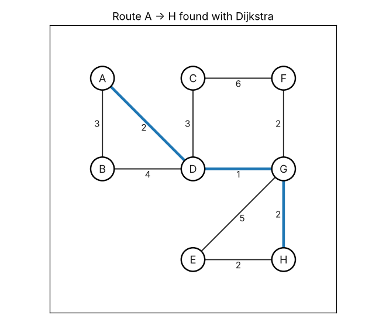

# SwitchingSys: circuit-switched network simulator

A Python simulator of a circuit-switched network in which **every node is a three-stage Clos switching fabric**. You set up and tear down end-to-end connections, and a connection only succeeds if every link on the route is free *and* every switch along the way can still route it through its internal stages.

Built for the Switching Systems course at Poznań University of Technology.



## What it does

- Models a network as a weighted graph whose nodes are Clos switches (input, middle and output stages).
- Finds routes with **BFS, DFS, Bellman–Ford or Dijkstra**, each extended with a per-hop feasibility check:
  - the link to the next node is not already carrying a connection, and
  - the current node's Clos fabric has a free middle switch between the incoming and outgoing port.
- Reserves the link and the switch paths when a connection is made, and releases them on disconnect.
- Simulates two kinds of blocking: **link blocking** (the cable is busy) and **internal blocking** (the switch has no free middle-stage path).
- Interactive command-line interface, JSON topology import and matplotlib visualisation.

## Quick start

Requires Python 3.10+.

```bash
pip install -r requirements.txt
python main.py
```

Example session on the built-in topology (shown in the image above):

```
3 - Make a connection        A -> H
3 - Make a connection        B -> F
3 - Make a connection        A -> F   [!] Connecting unsuccessful!
5 - List active connections
    0. A --> H; thru: (['A', 'D', 'G', 'H'])
    1. B --> F; thru: (['B', 'D', 'C', 'F'])
```

The third connection is refused: A–D is taken by the first connection, and the only other way out of A (A–B) leads to B, whose link to D is taken by the second.

### Using it from code

```python
from network import Network

node_map = {
    # node: ({neighbour: link weight}, (x, y) position for drawing)
    "A": ({"B": 1}, (0, 0)),
    "B": ({"A": 1, "C": 1}, (1, 0)),
    "C": ({"B": 1}, (2, 0)),
}

net = Network(directed=False, node_map=node_map, alg="dik")  # "bfs", "dfs", "b_f", "dik"
net.connect("A", "C")      # ['A', 'B', 'C'], or None if blocked
net.disconnect("A", "C")
net.graph.draw_graph(show=True)
```

The same format (as JSON) can be loaded from the CLI with option `0`.

## How the Clos switches are sized

Each node gets one port per neighbouring link. With `n` ports per input/output switch (default 4), a node with `N` links has `r = ceil(N / n)` input and output switches, and `m` middle switches.

By default `m = 2n − 1`, Clos's condition for a **strict-sense non-blocking** switch: any free input can always reach any free output, whatever is already connected. Passing a smaller value, e.g. `Network(..., middle_switches=1)`, makes nodes block internally, which lets you see Clos blocking happen. `tests/test_blocking.py` shows both cases.

## Project structure

| File | Contents |
|---|---|
| `clos.py` | Three-stage Clos switch: finding, reserving and releasing a middle-stage path |
| `graph.py` | Graph with BFS, DFS, Bellman–Ford and Dijkstra (each accepts an extra per-edge check) and matplotlib drawing |
| `network.py` | Ties them together: a Clos switch per node, link reservations, connect / disconnect |
| `app.py`, `main.py` | Interactive CLI |
| `tests/` | Unit tests for blocking, routing and disconnecting |

## Tests

```bash
python -m unittest
```

## Known limitations

- **Routing is greedy with respect to blocking.** Whether a hop is allowed depends on which node you arrived from (that decides the input port of the Clos switch), but the algorithms keep only one predecessor per node. In rare topologies they can report "no route" although a valid path exists through a different predecessor. An exact search would track states as (node, incoming link) pairs.
- Connections are point-to-point and each link carries one connection at a time.
- The topology can only be edited while no connections are active.
